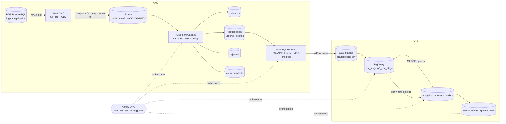

# AWS RDS → BigQuery CDC pipeline

A production-style, cross-cloud change-data-capture pipeline. It replicates an **Amazon RDS for
PostgreSQL** database into **Google BigQuery** through **AWS DMS → S3 → AWS Glue (PySpark) →
GCS → BigQuery MERGE**, orchestrated by **Apache Airflow**. It keeps each row's identity, the
operation type and the change order. Re-runs are idempotent, and INSERT, UPDATE and DELETE are
each handled explicitly.

The whole pipeline also **runs on a laptop**. A DMS simulator, local PySpark, filesystem
"buckets" and DuckDB (as a BigQuery stand-in) run the same code and SQL that production runs.



**DAG:** `check_new_cdc_files → run_glue_cdc_job → validate_glue_output → transfer_s3_to_gcs →
load_gcs_to_bigquery_staging → merge_staging_to_final → apply_deletes → update_watermark →
publish_audit_metrics`

## Contents

| Doc | What's in it |
|---|---|
| [ARCHITECTURE.md](ARCHITECTURE.md) | Design decisions; ordering, duplicates, deletes; failure model; trade-offs |
| [OPERATIONS.md](OPERATIONS.md) | Monitoring, restarts, slot lag, reprocessing, schema evolution, credential rotation |
| [COST_NOTES.md](COST_NOTES.md) | Cost drivers and levers |
| [docs/setup.md](docs/setup.md) | Full deployment walkthrough |
| [docs/dms_setup.md](docs/dms_setup.md) | DMS endpoints, task, metadata columns |
| [docs/airflow_setup.md](docs/airflow_setup.md) | Running the DAG (local, MWAA, Composer, Astro) |
| [docs/security.md](docs/security.md) | IAM, network paths, WIF, data residency |
| [docs/troubleshooting.md](docs/troubleshooting.md) | Common errors and fixes |

## Prerequisites

* **Local:** Python 3.11, [uv](https://github.com/astral-sh/uv), Java 17 (for PySpark), and
  optionally Docker (for the local PostgreSQL).
* **Cloud:** Terraform ≥ 1.6, AWS CLI, gcloud, `jq`, `psql`, plus an AWS account and a GCP
  project you're allowed to deploy into.

## Quickstart (local, ~2 minutes, no cloud account)

```bash
make venv && make install
```

```bash
make test          # unit + PySpark + DuckDB MERGE idempotency + DAG structure tests
```

```bash
make local-test    # 2 CDC batches through the whole pipeline, re-run each, then verify
```

```bash
make local-airflow # same, but executed by real Airflow (`airflow dags test`)
```

`make local-test` ends with `VERIFICATION PASSED`. That means the final tables match an
independent pure-Python reference model of the CDC semantics, and no primary key appears twice.

### With a real PostgreSQL source (Docker)

```bash
cp .env.example .env   # set SOURCE_DB_ADMIN_PASSWORD (local only)
```

```bash
make local-postgres    # postgres:16 with wal_level=logical + init scripts + replication slot
```

```bash
set -a; source .env; set +a; .venv/bin/python scripts/run_local_pipeline.py --reset --source postgres --batches 3
```

```bash
.venv/bin/python scripts/verify_bigquery_results.py --compare-postgres
```

`--source postgres` runs real INSERT/UPDATE/DELETE statements with `RETURNING *`. It turns
each change into a DMS-shaped record, using the transaction id and WAL LSN as metadata, and
advances the replication slot afterwards. `--compare-postgres` then checks that the live
replica rows match the source table.

## Local stand-ins

| Production | Local | Same code path? |
|---|---|---|
| AWS DMS | `scripts/generate_test_cdc_events.py` (synthetic or real PG DML), DMS-shaped JSONL | Glue reader handles both Parquet and JSONL |
| S3 / GCS | `local_data/s3/…`, `local_data/gcs/…` (`file://` ObjectStore) | Yes (`cdc_common.storage`) |
| AWS Glue | Same `glue/cdc_transform_job.run_transform` on local Spark | Yes |
| Glue Python Shell transfer | Same `transfer/s3_to_gcs_transfer.transfer_run` | Yes |
| BigQuery | DuckDB running the generated MERGE/DELETE SQL (DuckDB dialect) | Same SQL builder; only quoting and parameter syntax differ |
| LocalStack | Optional; `moto` covers S3 in unit tests | — |

A BigQuery emulator (`goccy/bigquery-emulator`) is an option, but it doesn't support MERGE
reliably. DuckDB runs the same MERGE semantics, so it's the documented stand-in.

## Configuration

Everything is driven by [`config/pipeline_config.yaml`](config/pipeline_config.yaml), with
`${VAR:-default}` placeholders resolved from the environment (see [.env.example](.env.example)):

* **tables:** primary keys, explicit typed columns, PII flags, staging/final names,
  partitioning, clustering.
* **cdc_fields:** maps DMS columns (`Op`, `_dms_commit_ts`, `_dms_change_seq`, …) to
  pipeline meaning.
* **storage:** raw/processed/GCS URIs (`s3://`, `gs://` or `file://`), raw format, zone
  prefixes.
* **pipeline:** `delete_strategy` (soft | hard), rejection threshold, watermark location and
  overlap.
* **bigquery:** backend (bigquery | duckdb), project, datasets, location.

The delete strategy can be set in three places, highest priority first: the DAG param
`delete_strategy`, the Airflow Variable `cdc_delete_strategy`, then the env var
`CDC_DELETE_STRATEGY`.

## Deploying (summary — details in [docs/setup.md](docs/setup.md))

```bash
cp infra/gcp/envs/dev.tfvars.example infra/gcp/envs/dev.tfvars   # then edit placeholders
```

```bash
make deploy-gcp ENV=dev        # GCS, datasets, SAs, Workload Identity Federation + BigQuery tables
```

```bash
make deploy-aws ENV=dev        # VPC, RDS, DMS, S3 (raw/processed/logs/artifacts), Glue, IAM, alarms
```

```bash
ENV=dev scripts/bootstrap_aws.sh   # from inside the VPC: schema, CDC prereqs, DMS user secret
```

```bash
ENV=dev GCP_PROJECT_ID=your-gcp-project-id scripts/bootstrap_gcp.sh   # WIF credential config -> Secrets Manager
```

Then set `dms_start_task = true` and re-apply. Deploy the DAG with `PIPELINE_ENV=cloud`,
`BQ_BACKEND=bigquery` and `RAW_FORMAT=parquet`, plus the bucket URIs and job names from the
Terraform outputs.

## Triggering the DAG

* **Scheduled:** hourly by default (`CDC_DAG_SCHEDULE`).
* **Manual, all tables:** `airflow dags trigger aws_rds_cdc_to_bigquery`
* **One table:** `airflow dags trigger aws_rds_cdc_to_bigquery -c '{"tables": ["orders"]}'`
* **Backfill a date:** `-c '{"ingest_date": "2026-11-04"}'`
* **Reprocess an exact run:** `-c '{"run_id": "cdc_20261105T100000Z"}'`
* **Hard deletes for one run:** `-c '{"delete_strategy": "hard"}'`

## Simulating CDC events

```bash
.venv/bin/python scripts/generate_test_cdc_events.py --batch 1   # full load + CDC (all edge cases)
```

```bash
.venv/bin/python scripts/generate_test_cdc_events.py --batch 2   # more CDC: re-insert, update, delete
```

Batch 1 covers inserts, updates, deletes, duplicate deliveries, out-of-order files, an
insert followed by a delete in the same batch, and four malformed records: broken JSON, an
unknown operation, a null primary key and a bad decimal. Small hand-written fixtures for each
case are in [`glue/tests/fixtures/`](glue/tests/fixtures).

## Verifying BigQuery results

```bash
.venv/bin/python scripts/verify_bigquery_results.py           # duplicates, metadata, audit (+ reference model locally)
```

[`bigquery/sql/dashboard_queries.sql`](bigquery/sql/dashboard_queries.sql) and the view
`cdc_audit.v_pipeline_health` show rows processed, failed rows, deletes applied, run duration
and the latest successful watermark. Both are ready to use as Looker Studio data sources.

## Repository layout

The layout follows the requested structure, with three additions. `cdc_common/` holds the
shared config, storage, paths, watermark and manifest code, used by every runtime.
`bigquery/sql_builder.py`, `warehouse.py` and `loader.py` generate and run the SQL; the files
in `bigquery/sql/*.sql` are generated by `make sql`, and CI checks they're up to date. Tests
also cover `cdc_common` and `bigquery`.

## Implementation checklist

| Area | Status | Needs cloud credentials | Manual configuration |
|---|---|---|---|
| Config, shared libs, structured logging | ✅ Done, tested | — | — |
| Source schema, seed data, CDC prereqs, local PG (Docker) | ✅ Done, run locally | — | Local password in `.env` |
| CDC fixtures + DMS simulator (synthetic & real PG) | ✅ Done, run locally | — | — |
| Glue PySpark transform (explicit schemas, validation, dedup, zones, manifest) | ✅ Done, run locally | Deploy: yes | — |
| S3→GCS transfer (manifest-scoped, MD5, idempotent, result metadata) | ✅ Done; local + moto-S3 tested | GCS write: yes | WIF credential config in Secrets Manager (`bootstrap_gcp.sh`) |
| BigQuery DDL/MERGE/deletes/audit (generated SQL) | ✅ Done; executed on DuckDB | BigQuery run: yes | `make deploy-gcp` creates tables |
| Airflow DAG (retries+backoff, SLA, alerts, params, backfill, rerun-safe) | ✅ Done; run with `airflow dags test` | Cloud mode: yes | Connections/Variables (`airflow/config/airflow_settings.yaml`), Slack webhook, alert emails |
| Terraform AWS (VPC, RDS, DMS, S3 ×4, IAM, Glue, KMS, Secrets, alarms, EventBridge) | ✅ `terraform fmt` + `terraform validate` pass (Terraform 1.9.8, AWS provider 5.x); **not applied** | Yes | `envs/<env>.tfvars`, state backend, `create_dms_service_roles` once per account |
| Terraform GCP (GCS, datasets, SAs, WIF, IAM, health view) | ✅ `terraform fmt` + `terraform validate` pass (Google provider 6.x); **not applied** | Yes | `envs/<env>.tfvars`, state backend |
| Bootstrap scripts | ✅ Written; syntax-checked only | Yes | Run `bootstrap_aws.sh` from inside the VPC |
| DMS on real AWS | ⚠️ Not run | Yes | Confirm the header expressions (`$AR_H_COMMIT_TIMESTAMP`, `$AR_H_TRANSACTION_ID`, `$AR_M_SOURCE_TABLE_NAME`) on your DMS engine version (docs/dms_setup.md) |
| CI (lint, tests, local pipeline, SQL drift, terraform validate) | ✅ `.github/workflows/ci.yml` | — | — |
